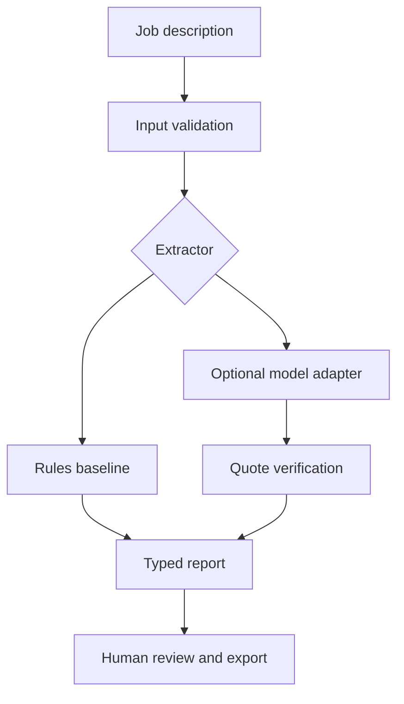

# AI Career Forge

**Build AI systems. Verify the evidence. Ship your portfolio.**

An original, project-based interactive engineering book by Nathaniel Hibbler. The planned curriculum connects hands-on AI development to evidence-backed career preparation, with a Dallas–Fort Worth focus.

## Current release: Chapter 1 working draft

**Build a Job Requirements Analyzer** — nine substantive lesson sections, twelve interactive practice challenges, a failure lab, an evidence-first analyzer, and deployment instructions.

| Implemented | Planned, not implemented |
| --- | --- |
| Portable browser reader and practice exercises | Chapters 2–30 |
| Python/Streamlit chapter application | Automated job discovery and freshness verification |
| Rules-based extraction with exact source evidence | Employer matching and adaptive learning |
| Optional structured-output AI adapter | Sandboxed arbitrary-code assessment |
| JSON exports, baseline evaluations, CI workflows | Accounts, durable learner profiles, verified credentials |

The browser baseline is **not an LLM**. Live AI requires server-side credentials, an enabled setting, and a compatible model; API use may cost money. Public demos should leave it disabled. Recorded or simulated behavior must never be presented as live model inference.

## Open the book immediately

Open [`web/index.html`](web/index.html) in a modern browser. Lessons and exercises work without Python or an API key. Fonts fall back to system fonts offline. Browser progress is local and exportable; short-answer practice does not execute arbitrary code or certify a skill.

Click **Run completed Chapter 1 project** to launch the finished browser reference application at any point. It immediately analyzes the fictional chapter posting, shows priorities and source evidence, supports custom input, and exposes the JSON report for inspection/export. Use **Return to my lesson** to resume reading. Previewing the reference does not mark exercises complete. The Python app includes the same launch button and a dedicated Completed project workspace.

Read the printable [Chapter 1 Markdown](docs/chapter-01.md), [curriculum roadmap](docs/CURRICULUM.md), and [assessment guide](docs/ASSESSMENT.md).

## Run the portfolio application

Python 3.11 or 3.12 is recommended; this draft was tested with Python 3.12.

```powershell
python -m venv .venv
.\.venv\Scripts\Activate.ps1
python -m pip install -r requirements.txt
python -m streamlit run app.py
```

On macOS/Linux replace the activation command with `source .venv/bin/activate`.

## Verify your work

Run from the repository root:

```bash
python -m unittest discover -s tests -v
python scripts/evaluate.py
python scripts/build_reader.py
node --check web/app.js
```

Node is only needed for the JavaScript syntax check. Edit `content/chapter1.json`, then rebuild the reader to synchronize the browser edition. The Markdown lesson source is generated from the same content; see `scripts/build_reader.py`.

## Architecture



- `career_forge/models.py`: Pydantic contracts.
- `career_forge/analyzer.py`: baseline and source-evidence checks.
- `career_forge/providers.py`: optional model integration.
- `app.py`: chapter, practice, analyzer, failure lab, checklist.
- `web/`: buildless interactive companion, suitable for Pages.
- `content/`: shared lessons, fictional posting, small evaluation dataset.
- `tests/`: extraction, provider mocks, and Streamlit interaction checks.

## Publish and deploy

- [Push to GitHub](docs/GITHUB.md)
- [Free deployment routes and optional live AI](docs/DEPLOYMENT.md)
- [Architecture decisions and limits](docs/ARCHITECTURE.md)
- [Coding-assistant feedback journal](docs/ASSISTANT-FEEDBACK.md)

## Evaluation boundaries

The synthetic benchmark is a smoke check, not a broad accuracy claim. Exact quotations do not prove correct interpretation. Mixed priorities, headings, negation, and unknown skills are documented baseline limitations. Skill mentions can be responsibilities rather than qualifications. No live model result or deployment is claimed by the source alone.

## Ownership and draft status

Prepared for Nathaniel Hibbler with AI-assisted development. No open-source license is granted in this draft; see [LICENSE](LICENSE). Review and select a license before inviting external reuse. No proprietary employer data or uploaded certificates are included.
